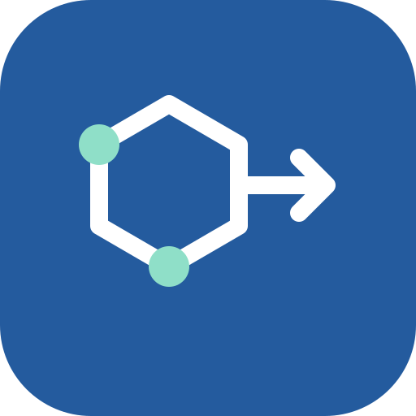
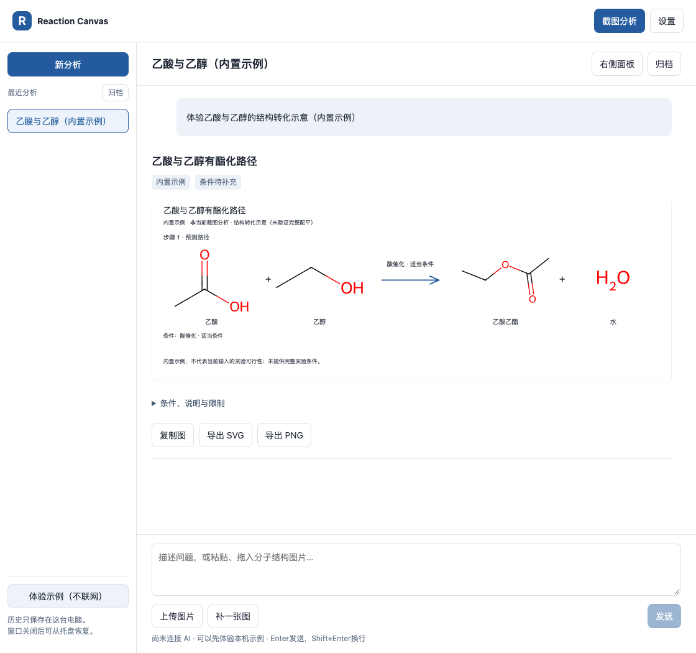
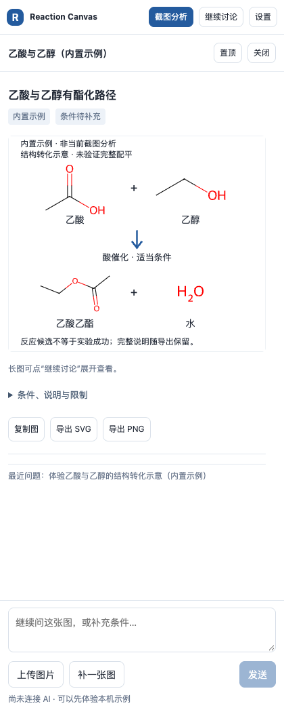

<p align="center"></p>

<h1 align="center">Reaction Canvas</h1>
<p align="center">Screenshot → reaction candidates → chemistry diagrams.</p>
<p align="center">A lightweight desktop research assistant. Bring your own AI; draw locally with RDKit.</p>
<p align="center"><a href="README.zh-CN.md">简体中文</a> · <a href="docs/GETTING_STARTED.md">Get started</a> · <a href="docs/PRIVACY.md">Privacy</a> · <a href="docs/ROADMAP.md">Roadmap</a></p>
<p align="center"><a href="LICENSE"></a>  </p>

Turn a molecular structure or patent screenshot into a discussion and a visual reaction candidate, without switching between a chat window and a drawing tool. The current interface is Simplified Chinese; the source and contributor docs are open to everyone.



*Built-in acetic-acid/ethanol example. Fixed demonstration data; this image does not demonstrate AI accuracy.*

## What you can do today

- Capture a screen region with `⌘/Ctrl + Shift + Space`, then inspect a compact panel at the right edge of your screen.
- Expand the same task into a normal discussion; paste, drag, or upload PNG/JPEG/WebP images and add text.
- Connect your own OpenAI-compatible model endpoint, including SiliconFlow or an existing local service. Image input requires a compatible vision model.
- Render model-provided SMILES locally with RDKit.js; copy diagrams or export SVG/PNG with conditions and uncertainty labels.
- Recover drafts and history, cancel requests, and back up or restore the local workspace.
- Try the built-in example without a key or network connection. No model weights, Python runtime, or dedicated GPU are bundled.

<details><summary>See the compact panel</summary>



</details>

## Try it

Read [installation and first use](docs/GETTING_STARTED.md). Downloadable builds, when published, appear under [Releases](https://github.com/tracy586ymz-eng/reaction-canvas/releases). Never enter credentials in an issue or discussion.

| Platform | Current evidence |
| --- | --- |
| macOS | Universal arm64 + x86_64 build produced locally; runtime checked on Apple Silicon. Ad-hoc signed, not notarized. |
| Windows | Capture implementation and NSIS build workflow included; installation and runtime validation are pending. |
| Linux | Not supported or tested by this MVP. |

This is an **experimental research aid**. Real-provider chemistry accuracy has not been measured. AI output can misread structures or invent plausible transformations. A valid SMILES drawing does not prove that a reaction works; exported diagrams are transformation schematics, not certified balanced equations. See [validation and limits](docs/VALIDATION.md).

## Privacy at a glance

API keys stay in the OS credential store and are separated by service address. History and images remain in local application data. After you configure and consent to a service, analysis sends the current task's text, selected images and relevant conversation to that service. Provider retention and pricing depend on the provider. There is no bundled operator key or built-in analytics upload. Local history is not encrypted by this app. See [the full data flow](docs/PRIVACY.md).

## Develop

Prerequisites: Node 24, Rust stable, and native platform build tools.

```sh
cd source/desktop
npm ci
node scripts/generate-notices.mjs
npm test
npm run tauri -- dev
```

Read [BUILD.md](source/desktop/BUILD.md) for native checks and installers. Architecture: React task/UI state → Tauri Rust capture, HTTP and credentials → user-selected model → validated result JSON → local RDKit SVG/PNG. The diagram renderer validates structures, not chemical feasibility.

## Help shape the project

Useful first contributions: English UI, Windows capture/installation validation, accessible keyboard flows, provider compatibility fixtures, and an evaluation set with positive **and negative** chemistry examples. [Contributor guide](CONTRIBUTING.md) · [Roadmap](docs/ROADMAP.md) · [Issues](https://github.com/tracy586ymz-eng/reaction-canvas/issues).

If this workflow is useful, a star helps people discover it. Reproducible bug reports and small pull requests help us improve it.

## Open-source credits

Built with [Tauri](https://github.com/tauri-apps/tauri), [React](https://github.com/facebook/react), [RDKit.js](https://github.com/rdkit/rdkit-js), reqwest and keyring. RDKit's WASM is unchanged; two Emscripten invoker factories are adapted for a strict desktop CSP and checked against upstream. Original project code is MIT; dependencies retain their own licenses. Build-time third-party notices are included in distributions; see [notices](source/desktop/licenses/THIRD-PARTY-NOTICES.md).
