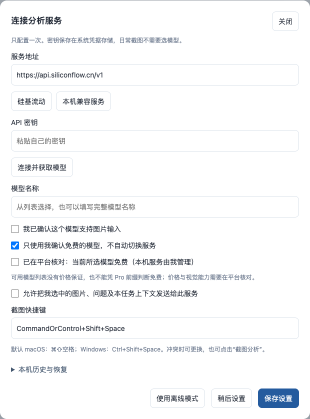

# 客户如何接入自己的 LLM

适用于 Reaction Canvas 0.1。客户只需准备 **服务地址、自己的 API 密钥、模型名称**，在软件「设置」里填一次，以后即可截图或发消息。云端模型不用在电脑下载，也不需要独立显卡。

初次使用可先点击「体验示例（不联网）」熟悉界面。内置示例是固定数据；要让 AI 分析自己的内容，仍需完成下面的连接设置。

## 第一次使用硅基流动

### 1 登录并创建自己的密钥

打开[硅基流动控制台](https://cloud.siliconflow.cn)，用自己的账号登录，进入 [API 密钥](https://cloud.siliconflow.cn/account/ak)，选择「新建 API 密钥」。可用 `Reaction Canvas` 作为备注，方便以后管理。复制完整密钥，稍后只粘贴到软件的「API 密钥」输入框。平台入口及流程见[官方快速上手](https://docs.siliconflow.cn/docs/userguide/quickstart)。

API 密钥用于授权程序调用模型。不要填登录密码、短信验证码或网页聊天账号；不要把密钥发到聊天、公开 Issue 或截图里。软件不提供共享密钥或赠送调用额度。

### 2 核对模型能力和费用

在平台模型详情里确认两件事：

- **能否读图**：截图分析需要支持「图片＋文字输入、文字输出」的视觉理解模型。只支持文字聊天或生成图片的模型不适用。硅基官方说明可在模型广场筛选「视觉」类模型，名单会调整，见[视觉理解说明](https://docs.siliconflow.cn/docs/userguide/capabilities/vision)。
- **如何收费**：核对当前模型价格、账号权限及可用额度。软件的模型列表只显示可用名称，不证明免费或支持图片。平台赠送余额、会员与模型本身免费也不是一回事。

这里不固定一个“永远免费”的模型名称。若账号没有符合要求的免费视觉模型，可先用免费文字模型做文字讨论；截图分析则需要另选你愿意承担费用的视觉模型，或使用合适的本机服务。勾选「支持图片」只是你的能力确认，不会让文字模型获得读图能力。

### 3 在 Reaction Canvas 填写设置

打开软件右上角「设置」，点击「硅基流动」。按下面填写：

图中密钥和模型均未填写，是隔离演示，不含客户账号或真实调用。

| 软件里的项目 | 应怎样填写 |
| --- | --- |
| 服务地址 | `https://api.siliconflow.cn/v1`，点击硅基流动按钮会填入 |
| API 密钥 | 刚在你自己账号创建的完整密钥；不加 `Bearer`、引号或其他文字 |
| 连接并获取模型 | 点击后应出现「连接成功，找到…个模型」 |
| 可用模型／模型名称 | 从列表选择刚核对过的模型；也可粘贴平台给出的完整模型 ID，保留大小写和斜线 |
| 我已确认这个模型支持图片输入 | 用于截图或上传图片时，在平台确认后勾选；只做文字问答可不勾选 |
| 只使用我确认免费的模型，不自动切换服务 | 使用当前确实免费的模型时保持勾选，并勾选下面的免费确认；选择收费模型时主动取消并接受供应商费用 |
| 允许把我选中的图片、问题及本任务上下文发送给此服务 | 阅读并同意后勾选；不同意则选择离线模式，可体验内置示例和查看已有图 |
| 保存设置 | 确认模型、费用和传输选择后点击 |

服务地址填的是 API 基础地址，不是控制台网页、聊天网页或完整的 `/chat/completions` 地址。软件会自己拼接接口。硅基流动的基础地址见[官方接入示例](https://docs.siliconflow.cn/docs/userguide/quickstart)。

“连接成功”只证明模型列表接口可访问。密钥在点击连接或保存时进入系统凭据存储；只关闭设置不会撤销平台密钥。如果需要清除本机保存值，点「移除当前服务密钥」；如果需要让密钥失效，到供应商控制台撤销。

### 4 做一次小测试

1. 点「新分析」，输入：`请分析乙酸与乙醇是否有酯化候选路径，缺失条件请注明，并给结构示意。` 点击「发送」。收到当前任务的回复，说明文字分析链路可用。
2. 用自己制作或获得授权的非机密结构图上传，再点击「发送」。上传、粘贴和拖入会先留下草稿；图片不会仅因上传就自动分析。
3. 图片测试可用后，按 Mac `⌘ + Shift + Space` 或 Windows `Ctrl + Shift + Space` 选区截图。成功截图会开始分析并显示右侧面板；Escape 取消。Mac 可能需要你在系统里允许屏幕捕获。

收到回复不等于反应判断准确。检查结构、条件和不确定性标识；内置示例、模型候选和文献转写应分开理解。图片结果缺失时，可先检查模型是否真正支持读图，而不是马上重建密钥。

## 已有其他平台或公司提供的 API

从供应商或公司管理员取得 **兼容接口的基础地址、密钥、完整模型 ID**，在同一个设置窗口替换填写。远程基础地址必须使用 HTTPS。保存后做上面的文字和图片测试。

当前支持 OpenAI 格式的 Chat Completions 兼容服务；这是接口格式，不要求购买 OpenAI 账号。供应商需要能接受软件的请求格式和返回可解析的模型内容。原生 Claude/Gemini 等不同格式的接口不能直接假定兼容，只有网页版聊天账号也不够。兼容性要求见 [LLM setup 的接口说明](LLM_SETUP.md#provider-compatibility)。

切换服务地址后要重新确认模型、价格和传输许可。密钥按服务地址分别保存，旧服务的密钥不会自动发给新服务。获取模型列表失败但你知道完整 ID 时，可以手填；如果分析接口也报错，仍需解决地址、密钥、权限或兼容性问题。

## 已有 Ollama 等本机服务

如果电脑已安装并运行本机服务，而且已经下载所需模型：

1. 在设置点击「本机兼容服务」，地址默认为 `http://127.0.0.1:11434/v1`。
2. 本机无认证服务的「API 密钥」留空，点击「连接并获取模型」，选择已安装模型；截图仍需视觉模型。
3. 确认本机服务由自己管理、内容传输方式及模型能力，再「保存设置」，做一次小测试。

Ollama 本机兼容接口见[官方文档](https://docs.ollama.com/api/openai-compatibility)。软件不会替客户安装 Ollama、下载模型或启动服务。本机模型占用客户电脑的内存／显存；小文字模型不能替代截图识别，也没有已验证的通用化学准确率。若本机服务实际调用云端模型，仍会发生外部传输和可能的供应商费用。

**0.1 的限制**：发送到 localhost／127.0.0.1 的请求不携带授权头，因此这里适用于无认证本机服务；需要密钥认证的本机服务暂未支持。公司内网 HTTP 地址也不能按本机地址使用；请向管理员索取允许使用的 HTTPS 兼容入口。不要为连接而关闭安全保护。

## 连接失败时怎么处理

| 看到的情况 | 先检查什么 |
| --- | --- |
| 连接失败／超时 | 网络和基础地址是否正确；本机服务是否运行；远程是否 HTTPS |
| 服务拒绝访问／401 或 403 | 是否粘贴完整有效密钥、模型是否有账号权限、供应商账号状态与额度；必要时在平台新建密钥并替换 |
| 找不到模型／404 | 是否填成网页地址或多加了 `/v1`；模型 ID 是否完整；供应商是否实现对应兼容接口 |
| 文字能用，图片失败／400 或 422 | 所选模型是否支持图片、是否正确确认视觉能力、供应商是否接受图片消息 |
| 429／限流 | 等待再试，查看平台当前配额；重复点击可能增加请求，软件不会自动改用另一个模型 |
| 免费确认不能保存 | 默认免费模式需要明确核实并勾选免费确认；若是收费模型，先确认费用，再主动取消免费模式 |
| 返回结果格式不正确／结果被截断 | 模型未按软件所需格式回答或输出不完整；缩短问题／新建任务，或换已确认兼容的模型；不能只靠“能聊天”证明适用 |
| 无法保存密钥 | 系统凭据存储是否可用和已解锁；不要改为把密钥写入普通文件或公开配置 |

免费模式是使用前的确认规则，不是实时价格检测或账单限额。软件不会自动切换模型，但供应商会按自己的规则处理调用。暂停本地等待也不保证供应商停止处理或计费；费用应在你的平台账单核对。

## 日常使用与隐私

设置完成后，客户直接截图、上传或讨论即可；无需每次选模型或输入密钥。联网分析会把当前任务文字、所选图片和必要上下文发给客户自己选择的服务；密钥存于本机系统凭据存储，不会作为化学问题内容发送。本机历史和备份含原图及讨论，软件未对它们额外加密，分享前需检查。

公开反馈只提供软件版本、系统版本、非机密复现步骤和经过检查的错误提示。不要上传真实调用正文、账号密钥、个人路径或完整工作区备份。完整数据流见[隐私说明](PRIVACY.md)。
